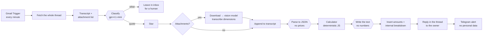

# ai-email-quote-agent

An **n8n email quoting agent** for a small manufacturer of made-to-measure products. Customers email "how much for…", often with a sketch or a photo. The agent reads the whole thread, extracts the dimensions, **prices them with deterministic code**, and replies with a ready quote **to the owner**, who checks it and forwards it to the customer.

**The language model never computes a price.** It classifies the email, turns free text into JSON, and writes the polite sentences around the numbers. Every amount comes from `src/calculator.mjs`.

It has run in production for a client since summer 2026. The client asked to stay anonymous, so **this repository uses a fictional catalogue** (roller blinds, pleated blinds, insect screens) and fictional rates. The architecture, the n8n workflow and the structure of the code are the production ones.

## Why it is built this way

| Decision | Reason |
|---|---|
| **The LLM parses, code prices** | Early versions let the model compute from a price list in the prompt. It got areas and offcuts wrong now and then, and an email with a wrong price looks exactly like a correct one. Now the model returns `{produkty: [...]}` and a pure function does the maths, with a full breakdown. |
| **No numbers from the writer** | The writer model gets the reply type and the thread, and returns text with a `[WYCENA]` token. The formatter inserts the amounts, the lead time and the conditions. If the token is missing, the block is appended anyway. |
| **The reply goes to the owner, not the customer** | The owner forwards the inquiry to the agent's mailbox and gets the answer back in the same thread: a customer-ready part on top, an internal breakdown below (`DO WEWNĘTRZNEGO UŻYTKU`). A human reads every quote before the customer does. |
| **Whole-thread memory** | Customers cut quotes or send HTML only, so quoted `>` lines are useless. The agent fetches the full Gmail thread and rebuilds one chronological transcript (`src/thread.mjs`). Dimensions given three emails ago still count; later corrections override earlier ones. |
| **When unsure, ask** | Unreadable parser output, missing dimensions or an unknown product never produce a guess. Missing items are listed as "not priced" without blocking the rest; if nothing can be priced, the reply asks for the data. A wrong number is worse than a question. |
| **Drawings through a vision model, fail-safe** | Up to 4 attachments (PDFs first, images under 30 kB dropped because they are signature logos) go to a vision model that only transcribes what it sees. Any error lets the run continue with the email text alone and leaves a note for the owner. |
| **Telegram without personal data** | The owner's alert carries the one-line summary and the amount, never the sender's name or address. |

## Architecture



Three reply types come out of the calculator: `wycena` (quote), `prosba_o_dane` (ask for missing data), `odmowa` (we do not make this).

### What the calculator does (`src/calculator.mjs`)

- One function per product. Several different products in one email are priced separately and summed.
- **Tiered price per m²** for screens, log-interpolated between tiers, plus a **small-format surcharge** `rate × (threshold / area)^k`. The exponent is fitted by least squares to a reference price list and smoothed, so the price never drops when the area grows (a test checks this from 0.1 to 10 m²).
- Minimum price, per-perimeter accessories, fabric group multipliers, an alternative variant (with/without cassette) offered every time.
- Installation: included by default, quoted separately when the customer says they install it themselves, skipped on "no installation".
- Rounding the way the owner rounds by hand: to 50 PLN, below 500 PLN to 10 PLN.
- Products quoted by hand (`NO_RATE`) and products the business does not make (`NOT_MADE`) are explicit lists, not prompt instructions.

### One source of truth for n8n and tests

n8n Code nodes cannot import files, so `scripts/build-workflow.mjs` inlines the modules from `src/` and the prompts from `prompts/` into `n8n/workflow.template.json` and writes `n8n/workflow.json`. The tests run the same code that n8n runs, and CI fails if `workflow.json` is out of date.

## Run it

```bash
npm test        # 30 tests: calculator, thread memory, attachments, formatter, vision step, workflow integrity
npm run demo    # offline: 5 fictional emails → calculator → reply (no model, no Gmail, no keys)
npm run build   # regenerate n8n/workflow.json after editing src/ or prompts/
```

No dependencies. Node 20 or 22.

To run it in n8n: import `n8n/workflow.json`, attach your own Gmail OAuth2, OpenAI and Telegram credentials to the nodes, replace `REPLACE_WITH_OWNER_CHAT_ID`, and point the Gmail Trigger at the mailbox the owner forwards inquiries to. Then replace `RATES` in `src/calculator.mjs` with your price list and run `npm run build`.

## Project layout

```
src/calculator.mjs   rates, per-product calculators, quote() → wycena | prosba_o_dane | odmowa
src/thread.mjs       Gmail thread → chronological transcript; attachment selection; sender parsing
src/vision.mjs       one vision request for all attachments; merge or fail-safe note
src/format.mjs       classifier output, [WYCENA] token → amounts, internal breakdown
prompts/             classifier, parser, writer, vision (Polish, the business is in Poland)
n8n/                 workflow template, glue code per Code node, generated workflow.json
scripts/             build-workflow.mjs
examples/cases.json  fictional emails with the parser output
test/                node:test suite
```

## Results in production

- Rates calibrated against **24 historical "dimensions → amount" pairs** taken from 120 real emails in the client's archive. Median absolute difference on the 13 cases with current prices: **3.6%**.
- The owner gets a ready quote with the full calculation instead of computing it by hand, and checks it before the customer sees it.

## Deliberate limitations

- The agent never sends anything to the customer. That is the design, not a missing feature.
- The email text and attachments go to the model provider (OpenAI). In production this runs on the client's own OpenAI account; check your data-processing terms before using it on customer emails.
- Classification and parsing are LLM steps and can fail. Every failure path falls back to "leave it for a human" or "ask for data", never to a guessed price.
- PDF input to the vision model uses the `file` content type; if your provider does not accept PDFs, rasterise them first.

---

Built by **Marcin Pakuła**, [AtomFlow](https://atomflow.pl): process automation and AI deployments. MIT License.
